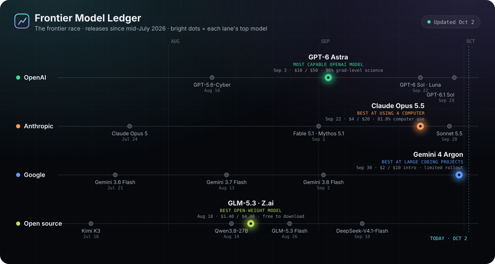
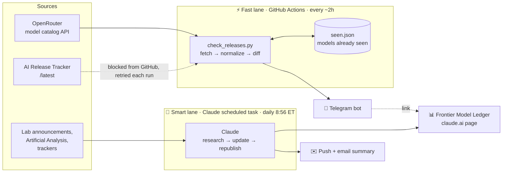

# Frontier Model Watch

**An automated watcher for frontier AI model releases.** It detects new models from the major labs, pings my phone on Telegram, and keeps a visual dashboard of the current frontier up to date. It runs on its own for $0.



<p align="center"><i>The opening view of the <a href="https://claude.ai/artifact/RD7Sw7sZTW77KqtCnzoeRq">Frontier Model Ledger</a>. Below it: category leaders, per-lab gains, head-to-head, capability-per-dollar and a strengths map.</i></p>

---

## What it does

| | |
|---|---|
| **Detects** | Checks public model catalogs every ~2 hours for new releases from OpenAI, Anthropic, Google, xAI, Meta, DeepSeek, Alibaba Qwen, Mistral, Moonshot, Z.ai and NVIDIA. |
| **Alerts** | Sends a Telegram message within hours: model, lab, release date, details link and dashboard link. |
| **Updates** | A daily Claude scheduled task researches what changed and updates the dashboard: timeline, leaders, benchmark gains, prices. |
| **Summarizes** | The same daily task sends a push notification and email summary when there's something new. |

**Telegram alert format**

```
New AI model: GPT-6.1 Sol
OpenAI · Sep 29, 2026
Release details
Open the Frontier Model Ledger
```

**The dashboard is phone-first.** The timeline becomes a vertical feed, lab rows stack, and every chart redraws for the screen width. Plain-language labels lead; technical benchmark names sit in small print.

---

## Architecture

Two independent lanes: a **fast lane** that never needs AI, and a **smart lane** that uses Claude to research and write.



### How a release flows through

```mermaid
sequenceDiagram
    participant Lab as AI lab
    participant OR as OpenRouter
    participant GH as GitHub Actions
    participant Me as My phone
    participant CL as Claude task
    participant D as Dashboard

    Lab->>OR: New model goes live
    GH->>OR: Poll catalog (every ~2h)
    GH->>GH: Normalize name, compare with seen.json
    GH->>Me: Telegram: New AI model · Lab · date
    GH->>GH: Commit updated seen.json
    Note over CL: Next morning, 8:56 ET
    CL->>Lab: Research launch posts, benchmarks, pricing
    CL->>D: Update timeline, cards, scores; republish
    CL->>Me: Push notification + email summary
```

---

## Components

| Component | Where it lives | Role | Cost |
|---|---|---|---|
| [`check_releases.py`](check_releases.py) | This repo | Detector: fetches sources, dedupes, sends alerts | $0 |
| [`.github/workflows/check.yml`](.github/workflows/check.yml) | This repo | Scheduler: runs the detector every ~2h, saves state | $0 (free Actions minutes, ~150 of 2,000/mo) |
| [`seen.json`](seen.json) | This repo | Memory: every model already seen | $0 |
| `TELEGRAM_BOT_TOKEN`, `TELEGRAM_CHAT_ID` | Repo secrets (encrypted) | Lets the detector message me | $0 |
| `DASHBOARD_URL` | Repo variable | Dashboard link added to every alert | $0 |
| Telegram bot `@frontier_model_watch_tomas_bot` | Telegram | Delivery to my phone | $0 |
| "Frontier model watch" scheduled task | Claude account | Researcher/editor that keeps the dashboard accurate | Included in Claude plan |
| [Frontier Model Ledger](https://claude.ai/artifact/RD7Sw7sZTW77KqtCnzoeRq) | claude.ai | Visual front end, shareable link | $0 |

---

## Design decisions

- **Two sources, one alert.** Model names are normalized (`GPT-6.1 Sol` → `gpt61sol`), so a model seen in both sources is announced once.
- **New sources start silent.** The first successful read of a source records everything already there without messaging, so adding or recovering a source can't flood the chat.
- **Flood guard.** More than 6 new models in one run arrive as a single digest message.
- **Fails loudly.** If every source fails, the run exits non-zero and GitHub emails me.
- **Stays alive.** A monthly heartbeat commit stops GitHub from pausing the schedule after 60 quiet days.
- **Separation of concerns.** Detection is plain Python with no AI, so alerts keep working even if the Claude task hits a usage limit. The dashboard never depends on the detector.
- **Dashboard rules.** Four timeline lanes: OpenAI, Anthropic, Google, and always a **best open-source** lane, chosen by the highest Artificial Analysis Intelligence Index among open-weight models. Each lane's top model is highlighted. Only figures from official announcements or reputable trackers are used.

---

## Run it yourself

- **Test now:** Actions → *Frontier Model Watch* → *Run workflow* (keep "Send a test message" ticked).
- **Change frequency:** edit the `cron` line in `check.yml` (`23 */2 * * *` = every 2 hours at :23).
- **Add a lab:** add its OpenRouter prefix to `LABS` in `check_releases.py`.
- **Re-announce a model (to test):** remove its `model:…` entry from `seen.json` and run the workflow.
- **Pause:** Actions → *Frontier Model Watch* → ··· → *Disable workflow*.

Full first-time setup steps are in [SETUP.md](SETUP.md).

## Known limits

- GitHub's free scheduler runs late, so checks come every ~2–6 hours rather than exactly every 2.
- AI Release Tracker blocks GitHub's servers, so OpenRouter carries detection. A model that's announced but not yet served on OpenRouter can be missed by Telegram; the daily Claude task catches it instead.
- Benchmark scores are lab-reported and tested differently by each lab, so cross-lab gaps are directional.

---

<sub>Built with Claude · Data sources: OpenRouter, AI Release Tracker, Artificial Analysis and the labs' own announcements.</sub>
